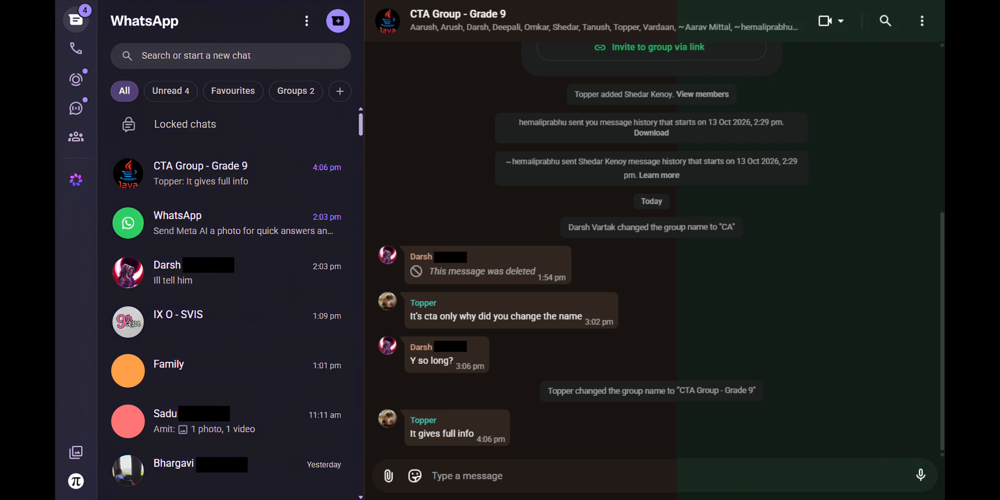

<h1 align="center">WhatsApp Revamp</h1>
<h3 align="center">

> a browser extension which gives themes to whatsapp web

[](https://developer.mozilla.org/en-US/docs/Web/JavaScript)

✦



\---

</h3>


## About
This is my first ever broswer extension which basically adds many themes to the website of whatsapp. It is not perfect but it does add themes to most of the components. The extension may stop working if WhatsApp randomly decides to change their element's names.


.

## Tech Stack
- **JavaScript** - 60%
- **CSS** - 28%
- **HTML** - 12%

.


## Themes
### Midnight
The normal whatsapp colors with a bluer tint to the accent

### Espresso
Gives whatsapp a browner, coffee like theme

### Amethyst
A purple theme inspired by Minecraft's amethyst shards or smt

### Forest
Makes your whatsapp look green and foresty, although i personally dont like it

### Onyx
A mix of black and yellow contrast which feels rich for some reason

### Royal
Sounds cool but its just the espresso theme but yellow


### Graphite
Looks similar to the original whatsapp theme but the accent is white making it grayscale


.

## AI Usage

ChatGPT has been only used for two of the following cases:

1 - As this is my first time creating an extension, I used ChatGPT to get familier with the ```manifest.json``` and other components like the content scripts structure.

2 - It was also used for generating hex codes for various themes and I picked the most good looking ones i guess.


<hr/>


<footer align="center">

.

[](https://github.com/hackclub)

Made with 🤍 by **Prasad Bahekar**

</footer>